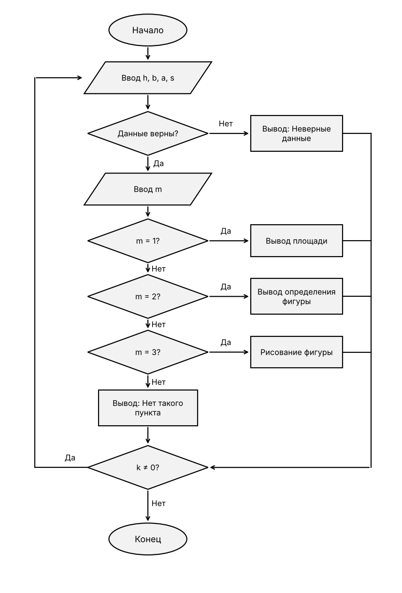

# Домашнее задание к работе 10

## Условие задачи

Задание 3 (индивидуальное). Составьте программу, которая для заданной пользователем фигуры 
(вариант 13 — прямоугольная трапеция) предлагает меню выбора одной из операций: 
1) рассчитать площадь
2) вывести определение фигуры
3) нарисовать фигуру.
Для каждой операции реализуйте собственную функцию.
Размеры фигуры (высота h, меньшее основание b, угол a при большем основании) и символ для рисования пользователь задаёт в main.

## Алгоритм
 
1. Начало.
2. Ввести высоту h, меньшее основание b, угол a и символ s.
3. Если данные неверные (h ≤ 0, b ≤ 0, a ≤ 0 или a ≥ 90), вывести «Неверные данные» и перейти к шагу 6.
4. Ввести номер пункта меню m.
5. Выполнить выбранный пункт:
   - m = 1: вывести площадь;
   - m = 2: вывести определение фигуры и её размеры;
   - m = 3: нарисовать фигуру символом s;
   - любое другое m: вывести «Нет такого пункта».
6. Спросить «Продолжить?» и ввести k.
7. Если k ≠ 0, вернуться к шагу 2.
8. Конец.
## Блок-схема

## Код

```c
#define _CRT_SECURE_NO_WARNINGS
#include <stdio.h>
#include <math.h>
#include <locale.h>
#define PI 3.14159265

float big(float h, float b, float a)
{
	float c;
	c = b + h / tan(a * PI / 180);
	return c;
}

float side(float h, float a)
{
	float d;
	d = h / sin(a * PI / 180);
	return d;
}

float area(float h, float b, float a)
{
	float s;
	s = (b + big(h, b, a)) / 2 * h;
	return s;
}

int draw(int h, int b, float a, char s)
{
	int i, j, w;
	for (i = 0; i < h; i++)
	{
		w = b + (int)(i / tan(a * PI / 180) + 0.5);
		for (j = 0; j < w; j++)
			printf("%c", s);
		printf("\n");
	}
	return h;
}

int main()
{
	setlocale(LC_ALL, "Russian");
	float h, b, a;
	char s;
	int m, k;

	do
	{
		printf("Введите высоту h: ");
		scanf("%f", &h);
		printf("Введите меньшее основание b: ");
		scanf("%f", &b);
		printf("Введите угол a при большем основании (в градусах, от 1 до 89): ");
		scanf("%f", &a);
		printf("Введите символ для рисования: ");
		scanf(" %c", &s);

		if (h <= 0 || b <= 0 || a <= 0 || a >= 90)
			printf("Неверные данные!\n");
		else
		{
			printf("\n1 - рассчитать площадь\n2 - вывести определение фигуры\n3 - нарисовать фигуру\n");
			printf("Ваш выбор: ");
			scanf("%d", &m);

			if (m == 1)
				printf("Площадь = %.2f\n", area(h, b, a));
			else if (m == 2)
			{
				printf("Прямоугольная трапеция - это четырехугольник, у которого\n");
				printf("две стороны параллельны (основания), а одна боковая сторона\n");
				printf("перпендикулярна основаниям (она равна высоте).\n");
				printf("Высота = %.2f, меньшее основание = %.2f\n", h, b);
				printf("Большее основание = %.2f, наклонная сторона = %.2f\n", big(h, b, a), side(h, a));
			}
			else if (m == 3)
				draw((int)h, (int)b, a, s);
			else
				printf("Нет такого пункта\n");
		}

		printf("\nПродолжить? (любое число / 0): ");
		scanf("%d", &k);
	} while (k != 0);

	return 0;
}
```

## Информация о разработчике

Коренев Сергей, группа 6ИД-261 подгруппа 2
